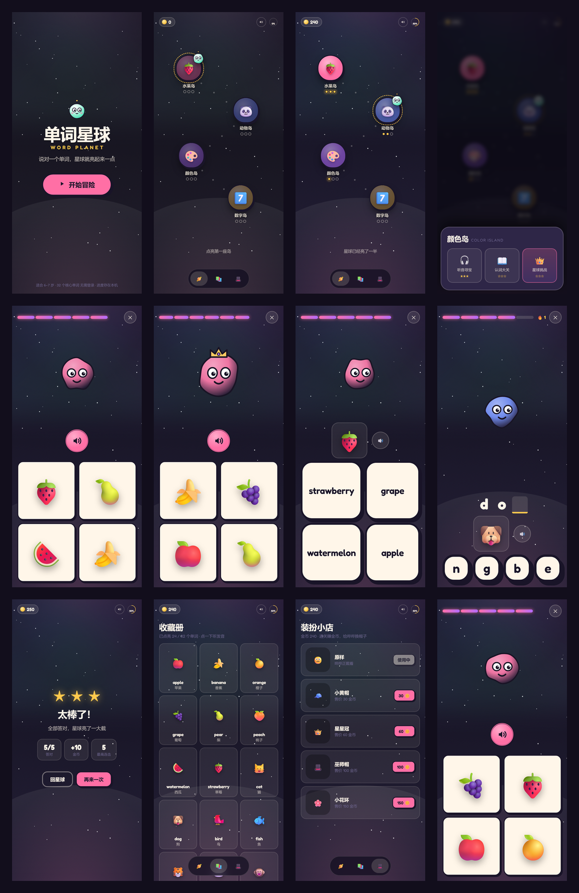

# 单词星球 Word Planet

给 6–7 岁中国孩子做的英语启蒙小游戏：**答对一个单词，星球就亮起来一点。**

打开 https://qiang-qiang-know.github.io/word-planet/ 直接玩（手机竖屏最佳，桌面浏览器也可以）。

## 玩法

- 4 座岛 × 3 关：听音寻宝（听发音选图）→ 认词大关（看图选词）→ 星球挑战（补缺失字母，本题量更多、金币翻倍，怪物戴皇冠）
- 32 个核心单词，全部带 emoji 图形，**零阅读门槛**：指令全靠图标 + 语音
- 答错不惩罚：不扣血、不重来，只把正确答案点亮并读一遍
- 每座岛自己会亮：星数攒满，岛的颜色从灰暗变饱和
- 金币攒着给吉祥物哔哔换帽子；还有收藏册

## 技术

- 单文件 `index.html`（283 KB），**离线可玩**，音效全部 Web Audio 实时合成、发音用 Web Speech API，没有任何音频文件
- 进度存在浏览器 localStorage，无需登录、无后端
- 27 个单元测试，`node tests/all.mjs`

设计文档与源码在本地项目目录，仓库里只放构建产物。
